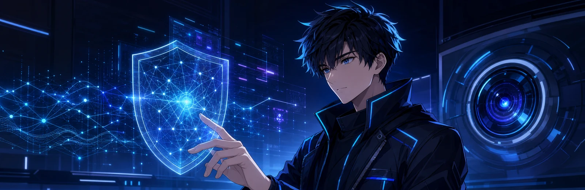

    

## What I'm building / 当前方向

- 🧭 **Enterprise RAG & Sales Agents** — 打造面向企业销售与售前团队的多品类智能产品选型与可追溯 RAG 知识库工作台（[SalesPilot AI](https://github.com/Du-professor/salespilot-ai)）。
- 🛡️ **Verifiable Security Auditing** — 构建基于 LangGraph 的本地 Web 与 CLI 漏洞主张审阅工作台，强调证据可追溯与离线可复现（[VulnGym System](https://github.com/Du-professor/vulngym-system)）。
- 🔐 **LLM security gateways** — 为 OpenAI 兼容应用构建本地安全网关，覆盖策略检查、提示词注入防护与模型推理。
- 🧩 **Auditable AI skills** — 沉淀可复用、可审查、可下载的 AI Skills 与自动化工作流。
- 🤖 **Robotic perception** — 探索 ROS 2、视觉 SLAM、占据栅格建图与 GPU 加速机器人系统。

I care about secure defaults, offline deployment, reproducible builds, and documentation that makes complex systems easier to adopt.

## Featured work / 精选项目

| Project | What it delivers | Core stack |
| --- | --- | --- |
| **[SalesPilot AI](https://github.com/Du-professor/salespilot-ai)** | 企业多品类智能产品选型与 RAG 知识库工作台，支持逐条引用校验、多模型网关配置与 Docker 企业级部署。 | `Python` `FastAPI` `Vue 3` `LangGraph` `pgvector` `Docker` |
| **[VulnGym System](https://github.com/Du-professor/vulngym-system)** | 共用 LangGraph T1 审核核心的本地 Web GUI 与 CLI 漏洞主张审阅系统，支持任务时间线与源码证据核验。 | `Python` `LangGraph` `SQLite` `Security Audit` |
| **[LLM Guard Agent](https://github.com/Du-professor/llm-guard-agent)** | 面向 OpenAI 兼容应用的本地安全网关，组合代理层、分类模型、规则与容器化部署。 | `Python` `Go` `ONNX` `Docker` |
| **[AI Skills Collection](https://github.com/Du-professor/AI-Skills-Collection)** | 可复用、可审查的 AI Skill 作品集，支持源码浏览与 ZIP 下载。 | `Python` `AI Skills` `Docs` `Automation` |
| **[ORB-SLAM3 Occupancy](https://github.com/Du-professor/ORB_SLAM3-OCCUPANCY)** | 基于 RealSense D415 与 ROS 2 Humble 的 ORB-SLAM3 稠密建图和 2D 占据栅格实践。 | `C++` `ROS 2` `RealSense` `ORB-SLAM3` |

## Engineering toolkit / 工程技术栈

              

## Collaboration / 开放合作

Open to collaboration on **LLM security, enterprise RAG & AI agents, secure AI infrastructure, intelligent robotics, and defensive security research**.

欢迎围绕 **大模型安全、企业级 RAG 与智能体工程、安全 AI 基础设施、智能机器人与防御性安全研究** 交流合作。
